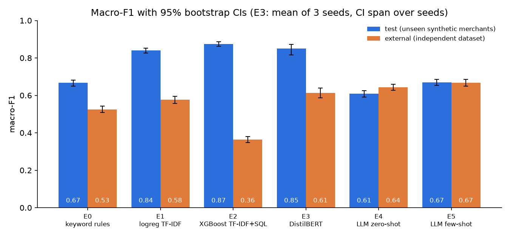
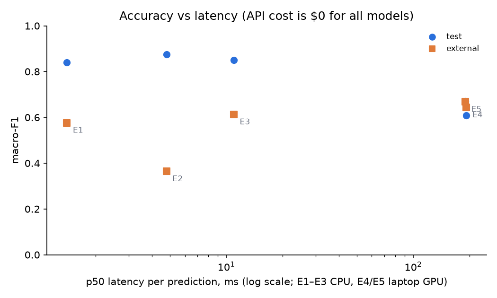
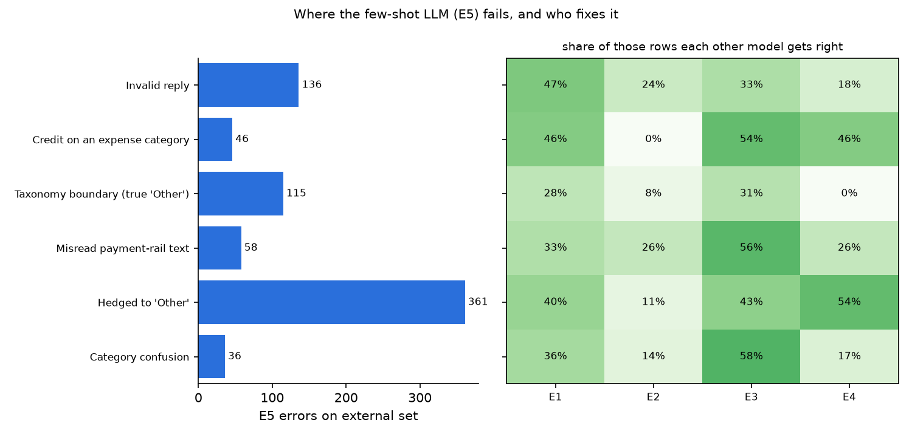

# Transaction Categorizer: classical ML vs. fine-tuned encoder vs. LLM

[](https://github.com/Jedges14/txn-categorizer/actions/workflows/ci.yml)

**In plain English:** this project teaches computers to file bank-statement lines like `SQ *BLUE BOTTLE 0423 OAKLAND CA`
into 13 small-business expense categories. It compares three approaches: XGBoost on SQL-built features, a fine-tuned
DistilBERT, and a free local LLM given a few examples. **Models trained on our data win on data like it** (XGBoost
0.875 macro-F1, statistically tied with DistilBERT). **On an independent dataset, the few-shot LLM wins** (0.667 vs
0.613 for DistilBERT and 0.364 for XGBoost; McNemar p ≤ 0.0012). It is also about 36× slower (190 ms vs 5 ms per
transaction on the same GPU), and every model costs $0 to run. Error analysis: about half of the LLM's mistakes are answering
"Other" for recognisable merchants, a habit tied to its few-shot examples (zero-shot almost never does it).

Plan: [SPEC.md](SPEC.md) · every number, with the command and commit that produced it: [RESULTS.md](RESULTS.md) ·
walk-through: [notebooks/03_results.ipynb](notebooks/03_results.ipynb)

## Results

Macro-F1 with 95% bootstrap CIs. Test = 3,204 synthetic rows from merchants never seen in training. External = 2,100
rows from an independent public dataset ([DoDataThings v2](data/README.md), MIT), mapped to 7 of our categories.

| Model | test | external | latency p50 (batch size 1) |
|---|---|---|---|
| E0 keyword rules | 0.666 | 0.525 | – |
| E1 logistic regression, TF-IDF | 0.839 [0.825, 0.852] | 0.576 [0.556, 0.595] | 1.4 ms CPU |
| E2 XGBoost, TF-IDF + SQL features | **0.875** [0.863, 0.886] | 0.364 [0.349, 0.380] | 4.8 ms CPU |
| E3 fine-tuned DistilBERT (3 seeds) | 0.850 ± 0.016 | 0.613 ± 0.005 | 11 ms CPU · 5.2 ms GPU |
| E4 LLM zero-shot (Qwen2.5-1.5B-Instruct, local) | 0.608 [0.591, 0.624] | 0.644 [0.627, 0.659] | 193 ms GPU |
| E5 LLM few-shot, 3 examples per category | 0.670 [0.653, 0.686] | **0.667** [0.649, 0.685] | 190 ms GPU |



**What it means**

- **On synthetic test data, XGBoost and DistilBERT are statistically tied.** XGBoost's 0.015–0.043 lead is
  significant against only one of DistilBERT's three seeds (exact McNemar, Holm-corrected). Both beat the LLMs
  (p < 1e-40).
- **On the independent set, the few-shot LLM is significantly better than every trained model.** That includes
  DistilBERT on all three seeds (p ≤ 0.0012).
- **Why the trained models drop on the independent set:**
  - The models fit to our synthetic generator generalize less well than a general-purpose model.
  - XGBoost collapses because it never saw rows without amounts or dates during training
    ([diagnosis](RESULTS.md#m2-sql-features-and-baselines-e0e2)).
- **Cost and speed:**
  - Nothing calls a paid API, so every model costs $0 per 1,000 predictions.
  - The trade-off is speed: the LLM takes about 190 ms per transaction, against 1–11 ms for the others.
  - For a live product, DistilBERT is the practical balance: within noise of the best on synthetic data, second best
    on independent data, and fast.



**Error analysis** of the LLM's 752 mistakes on the independent set ([full report](reports/error_analysis.md)):

| Error type | share of E5 errors | best other model on those rows |
|---|---|---|
| Recognisable merchant answered "Other" | 48% | zero-shot E4 (54% right) |
| Invalid reply ("Unknown", "Transfer") | 18% | logistic regression (47%) |
| True "Other" (groceries, pharmacy, ATM cash) given a business category | 15% | DistilBERT (31%) |
| Misread bank wording ("WITHDRAWAL FROM PG AND E" → Bank Fees) | 8% | DistilBERT (56%) |
| Refund or reversal read as Income | 6% | DistilBERT (54%) |
| Other category confusion | 5% | DistilBERT (58%) |

- Zero-shot answers "Other" for 0.3% of non-Other rows on the independent set. Few-shot does so for 18%, and for 88%
  of Square/Toast (`SQ *`, `TST*`) rows.
- One of the three "Other" examples it was shown is `SQ *MEMPHIS FLORIST`.
- This is a correlation; fixing it is a next step, to be validated on val only.



## Limitations

- **Training data is synthetic.** No public, licensed dataset of real labelled *business* transactions exists
  ([search log](data/README.md)). The generator draws from curated real merchant names, but many categories contain
  obvious cue words, so the synthetic test is easier than real statements.
- **There is no real test set.** The independent set is real-looking but is itself generated, and it is the closest
  stand-in available:
  - It is a different source with different string styles.
  - It covers only 7 of the 13 categories.
  - It has no amounts or dates.
  - It uses personal-finance labels, so groceries count as "Other".
  - The template for a private hand-labelled real test set is in `data/sample/`.
- **The LLM is small and local** (1.5B parameters). The SPEC envisaged a hosted LLM; this was replaced with a free
  open-weight model so nothing is paid for. A larger model would likely do better and cost money.
- **Latency was measured on one laptop** (Intel i7-13700H, RTX 4060 Laptop GPU), with LLM timings on GPU and E1–E2 on
  CPU. E1 and E2 were refit with their selected hyperparameters to time them, because the M2 run did not save models.
- **The error-type rules were written after reading a sample of errors.** They describe the errors and were not used
  to change any model.

## Next steps

1. **Few-shot example selection rule, chosen on val.** For example, exclude "Other" examples that start with a
   processor prefix, or use more examples per class. Rerun E5 and test whether the "Other" over-use drops.
2. **Constrained decoding:** let the LLM output only one of the 13 labels, which removes the 18% invalid replies.
3. **Hybrid router (SPEC E6):** use DistilBERT, and send only low-confidence rows to the LLM. Cost and latency stay
   near DistilBERT's while it borrows the LLM's robustness.
4. **Train XGBoost with randomly masked amounts and dates** (validated on val), so missing values aren't out of
   distribution.
5. **Hand-label a small private real test set** (`data/private/real_test.csv`, git-ignored) and rerun `txncat report`.

## Run locally

Requires Python 3.12–3.13, [uv](https://docs.astral.sh/uv/) and Docker. No API keys: the LLM is an open-weight model
that runs locally.

```bash
docker compose up -d          # PostgreSQL 16 on localhost:5433 (schema created on first start)
uv sync                       # create .venv with pinned dependencies
uv run txncat db check        # confirm the database is reachable
uv run txncat data build      # data/merchants.csv + data/generated/synthetic.csv (seed 42)
uv run txncat data external   # download the pinned external test dataset (MIT, checksum-verified)
uv run txncat data load       # into Postgres (synthetic + external test; + private real test if present)
uv run txncat data report     # reports/data_summary.md + reports/figures/class_distribution.png
uv run txncat train baseline  # E0-E2 (about 11 min); predictions/ + reports/metrics/baseline.json
uv sync --extra encoder; uv run txncat train finetune   # E3, 3 seeds (about 42 min on CPU)
uv run --no-sync txncat llm run --mode zero   # E4, free local LLM (needs the encoder extra)
uv run --no-sync txncat llm run --mode few    # E5
uv run --no-sync txncat bench latency        # per-prediction latency E1-E3 -> reports/metrics/latency.json
uv run txncat report          # tables, McNemar/Holm, bootstrap CIs, figures (from saved predictions only)
uv run txncat errors          # error analysis -> reports/error_analysis.md
uv run pytest                 # tests (DB tests skip if Postgres isn't running)
uv run pre-commit install     # run ruff + repo checks on every commit
```

`predictions/` and `reports/` are committed. `txncat report` rebuilds every table and figure from them alone, with no
database, model or network.

**Optional NVIDIA GPU** (about 5× faster for E4/E5): the locked environment installs CPU-only torch. To use a GPU,
swap the CUDA build into the project's venv (the driver must support CUDA 13.2):

```bash
uv pip install --python .venv/Scripts/python.exe --reinstall --no-deps "torch==2.15.0+cu132" --index-url https://download.pytorch.org/whl/cu132
```

Then run commands with `uv run --no-sync …`, because a plain `uv run` re-syncs back to the CPU build. Always pass
`--python`, so the install can't land in another Python on your machine.

## Layout

```
src/txncat/   cli.py (txncat), config.py, db.py
              data/ (generator, splits, external set) · features/ (SQL + TF-IDF) · models/ (E0–E5, LLM client)
              eval/ (metrics, significance, latency, report, error analysis)
sql/          001_schema.sql, 002_external_test.sql, features.sql (cleaning functions + txn_features view)
prompts/      system.md (LLM instructions + category definitions)
data/         taxonomy.yaml, merchants.csv, sample/ (fake rows) · private/ (your real labels; git-ignored)
              how the data was made and its limitations: data/README.md
predictions/  every model's prediction for every evaluated row
reports/      results_tables.md, error_analysis.md, metrics/*.json, figures/*.png
notebooks/    01_eda.ipynb, 02_finetune_colab.ipynb, 03_results.ipynb (executed)
tests/        114 tests: data/splits (no merchant in two splits), SQL cleaning, models, LLM parsing, statistics,
              error typing, repo hygiene, Postgres integration
```

## Data privacy

`data/private/` is git-ignored, and a pre-commit hook and a test fail if anything there is ever staged or tracked. CI
never calls paid APIs.
