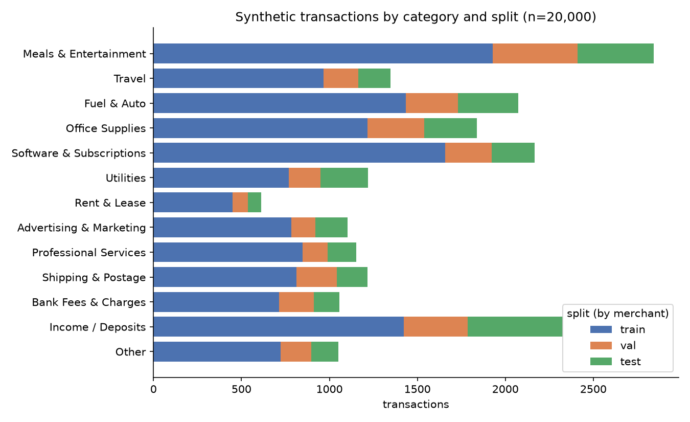

# Transaction Categorizer: classical ML vs. LLM

[](https://github.com/Jedges14/txn-categorizer/actions/workflows/ci.yml)

Sorts short bank-transaction descriptions (e.g. `SQ *BLUE BOTTLE 0423 OAKLAND CA`) into small-business expense
categories, and compares an XGBoost baseline on SQL-engineered features, a fine-tuned small transformer, and a
few-shot LLM on accuracy, macro-F1, statistical significance, cost and latency. Plan: [SPEC.md](SPEC.md).

> Status: **M4 (LLM evaluation) done.** Data: 20,000 synthetic transactions split by merchant, plus a
> 2,100-row external test set from an independent dataset (no real-transaction test set exists; see
> [data/README.md](data/README.md)). Every number is in [RESULTS.md](RESULTS.md) with the command that produced it.

**Results so far** (macro-F1; test = unseen synthetic merchants, external = independent dataset; E3 = mean ± std of 3 seeds):

| Model | test | external |
|---|---|---|
| E0 keyword rules | 0.666 | 0.525 |
| E1 logistic regression, TF-IDF | 0.839 | 0.576 |
| E2 XGBoost, TF-IDF + SQL features | **0.875** | 0.364 |
| E3 fine-tuned DistilBERT | 0.850 ± 0.016 | 0.613 ± 0.005 |
| E4 LLM zero-shot (Qwen2.5-1.5B, local, $0) | 0.608 | 0.644 |
| E5 LLM few-shot, 3 examples/category | 0.670 | **0.667** |

The trained models win on synthetic test data; the free local LLM, never trained on that data, generalizes best to the
independent set. XGBoost collapses there because it never saw rows without an amount or date during training
(diagnosed in RESULTS.md). Significance tests come in M5.



## Run locally

Requires Python 3.12–3.13, [uv](https://docs.astral.sh/uv/) and Docker.

```bash
docker compose up -d          # PostgreSQL 16 on localhost:5433 (schema created on first start)
uv sync                       # create .venv with pinned dependencies
uv run txncat db check        # confirm the database is reachable
uv run txncat data build      # data/merchants.csv + data/generated/synthetic.csv (seed 42)
uv run txncat data external   # download the pinned external test dataset (MIT, checksum-verified)
uv run txncat data load       # into Postgres (synthetic + external test; + private real test if present)
uv run txncat data report     # reports/data_summary.md + reports/figures/class_distribution.png
uv run txncat train baseline  # E0-E2 (about 11 min); predictions/ + reports/metrics/baseline.json
uv sync --extra encoder; uv run txncat train finetune   # E3, 3 seeds (about 42 min on CPU)
uv run --no-sync txncat llm run --mode zero   # E4, free local LLM (needs the encoder extra)
uv run --no-sync txncat llm run --mode few    # E5
uv run pytest                 # tests (DB tests skip if Postgres isn't running)
uv run pre-commit install     # run ruff + repo checks on every commit
```

No API keys are needed: the LLM is an open-weight model that runs locally.

**Optional NVIDIA GPU** (about 5× faster for E4/E5): the locked environment installs CPU-only torch. To use a GPU on
your machine, swap in the CUDA build into the project's venv (driver must support CUDA 13.2):

```bash
uv pip install --python .venv/Scripts/python.exe --reinstall --no-deps "torch==2.15.0+cu132" --index-url https://download.pytorch.org/whl/cu132
```

Then run commands with `uv run --no-sync …` (a plain `uv run` re-syncs back to the CPU build). Always pass `--python`
so the install can't land in another Python on your machine.

## Layout

```
src/txncat/   cli.py (txncat), config.py, db.py; data/ (M1); features/ models/ eval/ filled in M2–M5
sql/          001_schema.sql (transactions table); features.sql arrives in M2
data/         taxonomy.yaml, merchants.csv, sample/ (fake rows) · private/ (your real labels; git-ignored)
              how the data was made and its limitations: data/README.md
notebooks/    01_eda.ipynb (executed)
tests/        CLI, data/splits (no merchant in two splits), repo hygiene, schema + loading against real Postgres
```

## Data privacy

`data/private/` is git-ignored, a pre-commit hook and a test fail if anything there is ever staged or tracked, and
CI never calls paid APIs.
