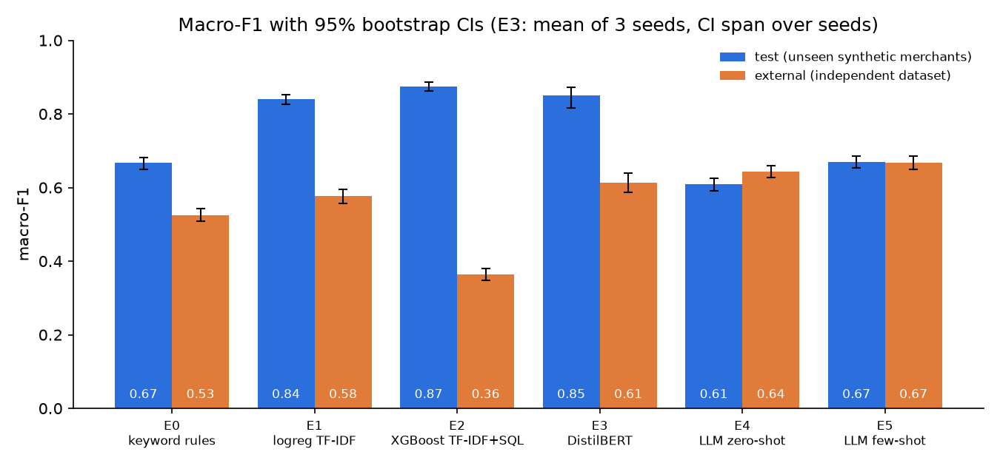
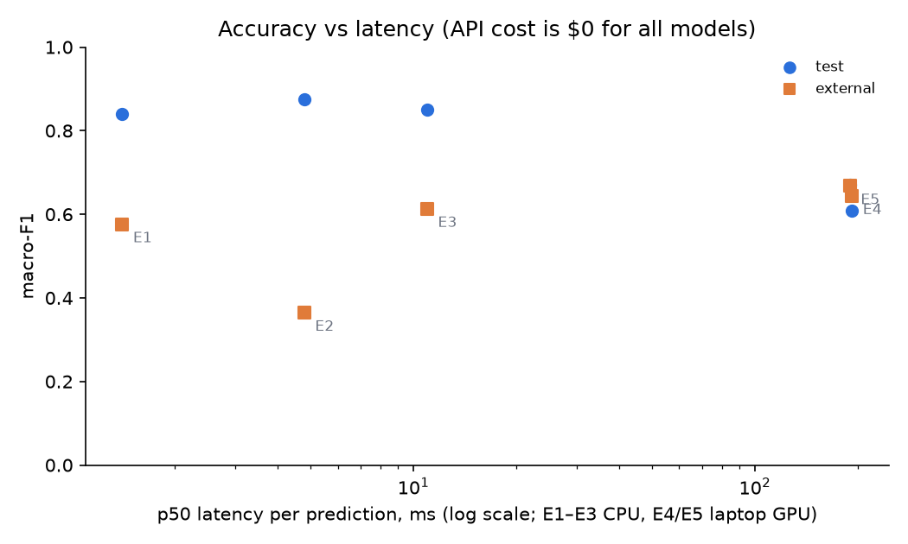
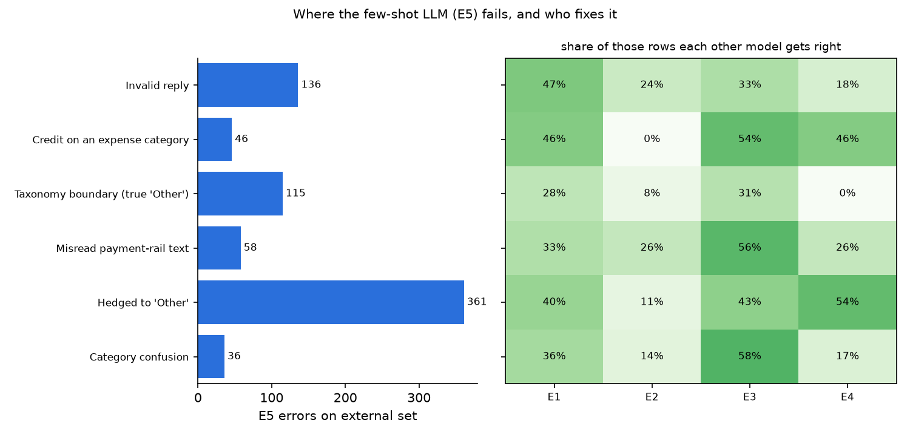

# Results

Every number here came from a command run in this repo, with the date and git commit.

**Machine:** Windows 11 laptop, Intel Core i7-13700H, Python 3.12.10, PostgreSQL 16.16 (Docker).

## M1: Data

Date: 2026-11-26 · Commit `7501122` (CI green) · Commands:

```bash
uv run txncat data build    # seed 42
uv run txncat data load
uv run txncat data report
```

- **20,000 synthetic transactions** loaded into PostgreSQL (`SELECT count(*) FROM transactions` → 20000):
  train 13,729 (68.6%) · val 3,067 (15.3%) · test 3,204 (16.0%).
- **4,997 merchants** in `data/merchants.csv` (384 per category on average, 277–400), split 70/15/15 by merchant
  within each category; **0 merchants appear in more than one split** (`tests/test_data.py`, `notebooks/01_eda.ipynb`).
- **13 categories**, imbalanced: largest/smallest = **4.6×** (Meals & Entertainment 2,842 rows vs Rent & Lease 613).
  Per-category counts: [`reports/data_summary.md`](reports/data_summary.md).
- **Shortcut check** (share of a category's rows containing an obvious cue word; `notebooks/01_eda.ipynb`):
  Bank Fees 0.64 · Shipping 0.61 · Utilities 0.52 · Rent & Lease 0.57 · Travel 0.63 · Fuel & Auto 0.60 ·
  Professional Services 0.66. The synthetic set is likely easier than real statements; see
  [`data/README.md`](data/README.md#4-known-limitation-the-synthetic-set-may-be-easier-than-reality).
- **Real test set:** none (0 rows). No public, licensed dataset of real labeled business transactions was found, and
  no private one is available.
- **External test set** (added after the entry above; see the next section).
- Existing-dataset search: documented in [`data/README.md`](data/README.md#1-existing-datasets-searched-not-used-for-training);
  none used for training.

## M1: External test set

Date: 2026-11-26 · Commit `9056c3b` · Commands:

```bash
uv run txncat data external   # DoDataThings/us-bank-transaction-categories-v2 @ 3e8d052c, SHA-256 0424aed6…
uv run txncat data load
uv run txncat data report
```

- **2,100 rows** loaded as split `external_test`: 300 each for Meals & Entertainment, Travel, Utilities, Rent & Lease,
  Bank Fees & Charges, Income / Deposits, Other (7 of 13 categories). 0 rows have an amount or date (none exist in the
  source); `direction` is set on all.
- **19.7%** (414/2,100) mention a merchant name from the train split: Travel 103, Income 98, Bank Fees 82,
  Utilities 72, Meals 30, Other 29, Rent 0.
- It is an independent **synthetic** dataset, not real data; see [`data/README.md`](data/README.md#6-external-test-set-txncat-data-external-then-txncat-data-load).

## M2: SQL features and baselines (E0–E2)

Date: 2026-11-26 · Code: commit `7f1b315` (the run was recorded as `46d8cf3+uncommitted`, i.e. this exact code before
it was committed) · Command: `uv run txncat train baseline` (641 s on the laptop above) · Raw:
[`reports/metrics/baseline.json`](reports/metrics/baseline.json), predictions in [`predictions/`](predictions/).

Hyperparameters chosen on **val only**: E1 `C=0.3` (of 0.3/1/3/10, class-balanced); E2 `max_depth=4,
learning_rate=0.1, min_child_weight=1`, 278 trees by early stopping (best of a 12-config grid), on the top 5,000
TF-IDF columns by chi-squared (selected on train) + 11 SQL features. Test sets were scored once, after selection.

| Model | val macro-F1 | test accuracy | **test macro-F1** | external accuracy | **external macro-F1** | external, unseen merchants (n=1,686) |
|---|---|---|---|---|---|---|
| E0 majority class (Meals) | 0.021 | 0.135 | 0.018 | 0.143 | 0.036 | 0.039 |
| E0 keyword rules | 0.674 | 0.662 | 0.666 | 0.529 | 0.525 | 0.510 |
| E1 logistic regression, TF-IDF | 0.852 | 0.854 | 0.839 | 0.531 | **0.576** | 0.469 |
| E2 XGBoost, TF-IDF + SQL features | 0.877 | 0.886 | **0.875** | 0.333 | 0.364 | 0.329 |

Test = 3,204 synthetic rows from merchants never seen in training. External = 2,100 rows from an independent dataset,
7 of 13 categories, no amounts or dates (macro-F1 averages those 7 classes).

**Reading it**
- On the synthetic test split, E2 beats E1 by 0.036 macro-F1. Per-class E2 test F1 ranges from 0.73 (Advertising &
  Marketing) to 1.00 (Income / Deposits). Income ≈ 1.00 and Bank Fees 0.99 were checked: Income is the only category
  with money coming in (refunds carry a REFUND/RETURN prefix), and 64% of fee rows say "FEE" (M1 shortcut check).
  These are properties of the synthetic data, not a leak, and are why the external set matters.
- **On the external set the ranking flips: E2 collapses (0.364) below the keyword rules (0.525), and E1 is best
  (0.576).** E2 predicts "Professional Services" for 1,003 of 2,100 external rows.
- All models score lower on external rows whose merchant was never seen in training (E1 0.576 → 0.469).

**Diagnosis of the E2 collapse** (post-hoc, does not replace the headline E2; same selected hyperparameters, no
re-tuning) · Command: `uv run python scripts/diagnose_e2_external.py` · Raw:
[`reports/metrics/e2_external_diagnostic.json`](reports/metrics/e2_external_diagnostic.json)

| E2 variant | test macro-F1 | external macro-F1 |
|---|---|---|
| all features (headline) | 0.875 | 0.364 |
| without string-format features (`desc_len`, `digit_ratio`, `has_processor_prefix`) | 0.873 | 0.378 |
| **without amount and date features** | 0.830 | **0.594** |
| text only | 0.830 | 0.527 |

- First hypothesis (string-format features don't transfer) was **wrong**: removing them changes little.
- Cause: **missing values never seen in training.** Every training row has an amount and a date; every external row
  has neither, so the trees send all of them down whichever branch they defaulted to. Without amount/date features,
  E2 recovers to 0.594 (above E1) at a cost of 0.045 on the synthetic test.
- Takeaway: amount and date features help (+0.045 macro-F1) when present, but a model must be trained to cope when
  they're absent. Planned fix, chosen on principle and to be validated on **val with amounts masked**, never on the
  external set: train with randomly masked amount/date features (missingness augmentation).

## M3: Fine-tuned encoder (E3)

Date: 2026-11-26 · Code: commit `95b7df3` (run recorded as `678913d+uncommitted`: this code before commit) ·
Command: `uv sync --extra encoder && uv run txncat train finetune --seeds 0 1 2 --epochs 3` · Hardware: the laptop
CPU above (14 torch threads, no GPU), about 14 min per seed · Raw: [`reports/metrics/e3_finetune.json`](reports/metrics/e3_finetune.json),
predictions `predictions/E3_finetune_seed{0,1,2}.csv` · Model card: [`docs/model_card_e3.md`](docs/model_card_e3.md).

DistilBERT (uncased, revision `12040acc`), text only (`desc_clean`), class-weighted loss, lr 5e-5, batch 32,
3 epochs; best epoch per seed chosen on **val** (epochs 3, 2, 3). No other tuning.

| Seed | val macro-F1 | test macro-F1 | external macro-F1 | external, unseen merchants |
|---|---|---|---|---|
| 0 | 0.879 | 0.858 | 0.608 | 0.532 |
| 1 | 0.883 | 0.831 | 0.619 | 0.556 |
| 2 | 0.881 | 0.860 | 0.611 | 0.539 |
| **mean ± std** | 0.881 ± 0.002 | **0.850 ± 0.016** | **0.613 ± 0.005** | **0.542 ± 0.013** |

Accuracy, mean ± std: test 0.871 ± 0.021, external 0.585 ± 0.011.

**All models so far** (macro-F1; E3 is the 3-seed mean):

| Model | test | external | external, unseen merchants |
|---|---|---|---|
| E0 keyword rules | 0.666 | 0.525 | 0.510 |
| E1 logistic regression, TF-IDF | 0.839 | 0.576 | 0.469 |
| E2 XGBoost, TF-IDF + SQL features | **0.875** | 0.364 | 0.329 |
| E3 fine-tuned DistilBERT | 0.850 ± 0.016 | **0.613 ± 0.005** | **0.542 ± 0.013** |

**Reading it**
- On the synthetic test split, E2 is still highest; E3 sits between E1 and E2, and its seed-to-seed spread (0.831–0.860)
  is as large as some model-to-model gaps. Whether these differences are significant is M5's job (McNemar's test,
  bootstrap CIs), so no ranking claim is made here.
- On the independent external set, E3 is best of all models and most stable across seeds (std 0.005), with the
  largest margin on merchants never seen in training (0.542 vs E1 0.469). Being text-only, it avoids E2's
  missing-feature failure.
- Every model loses a lot moving from synthetic test to external data (E3: 0.85 → 0.61). That gap, not the synthetic
  scores, is the main limitation to report.

## M4: LLM zero-shot (E4) and few-shot (E5), free local model

Date: 2026-11-26 · Code: commit `9528a02` (the runs recorded HEAD `1f10ec0`, a docs-only commit on top; `src/` and
`prompts/` are identical) · Commands: `uv run --no-sync txncat llm run --mode zero` and `--mode few` · Raw:
[`reports/metrics/E4_llm_zero_shot.json`](reports/metrics/E4_llm_zero_shot.json),
[`reports/metrics/E5_llm_few_shot.json`](reports/metrics/E5_llm_few_shot.json), predictions in `predictions/E4_*`, `E5_*`.

**Model:** [Qwen2.5-1.5B-Instruct](https://huggingface.co/Qwen/Qwen2.5-1.5B-Instruct) (Apache-2.0, revision
`989aa798`), run locally, greedy decoding, max 16 new tokens. **No paid API: cost $0.** Hardware: NVIDIA GeForce RTX
4060 Laptop GPU (8 GB), bf16, CUDA build of torch 2.15.0 installed locally (CI stays CPU-only). Prompt: instructions
+ 13 category definitions ([`prompts/system.md`](prompts/system.md)); each transaction is one user turn with its
description, amount (or "unknown") and direction. E5 adds 3 examples per category (39) from **train only**, seed 42.
The prompt and parser were written before any test/external results and not changed afterwards.

| Model | test macro-F1 | test accuracy | external macro-F1 | external accuracy | external, unseen merchants | invalid replies (test / external) |
|---|---|---|---|---|---|---|
| E4 zero-shot | 0.608 | 0.679 | 0.644 | 0.644 | 0.624 | 39 / 26 |
| E5 few-shot (k=3/class) | 0.670 | 0.720 | **0.667** | 0.642 | **0.640** | 16 / 136 |

Invalid replies (not one of the 13 categories) are counted and scored as wrong, never dropped.

**Latency and cost** (per prediction, GPU, measured when first generated): E4 p50 193 ms / p95 289 ms; E5 p50 190 ms /
p95 291 ms. Cost per 1,000 predictions: **$0** (local open-weight model). For reference, the earlier CPU pilot ran at
~1,020 ms per prediction (not used for results). 22 rows per run were answered from the response cache because their
prompt was identical to an earlier row (duplicate description + amount); they keep that row's answer and latency.

**Reading it**
- On the synthetic test split the LLMs trail the trained models (E2 0.875, E3 0.850). They were never trained on this
  generator's data, so they can't exploit its quirks.
- **On the independent external set the LLMs are the best models:** E5 0.667 and E4 0.644 vs E3 0.613, E1 0.576, E2
  0.364, and the margin is largest on unseen merchants (E5 0.640 vs E3 0.542). This fits the M1 warning that the
  synthetic set is easier than other data: models fit to it generalize less well than a general-purpose model.
- **Invalid replies:** few-shot cut them on test (39 → 16) but raised them on external (26 → 136). Of the 136, 86 are
  "Unknown" and 48 are "Transfer"/"Transfer Between Own Accounts" (true labels mostly Utilities and Other). Likely cause:
  every few-shot example comes from train and so has a real amount, while external rows say "Amount: unknown", which
  the model echoes; and "Transfer" is a natural name the examples didn't rule out. Not fixed, because choosing a fix from
  external results would be tuning on test data; it's an error-analysis item for M6.
- Significance of these differences is tested in M5.

## M5: Significance, confidence intervals, cost and latency

**Commands:** `txncat bench latency` (2026-11-27, commit `6221327`), then `txncat report` (2026-11-27, commit
`b29dd97`; same code as `b761c3f`). `txncat report` reads only `predictions/*.csv` and `reports/metrics/*.json`: no database, model or network.
It regenerates [`reports/results_tables.md`](reports/results_tables.md) (every table below, in full),
`reports/metrics/significance.json` (per-seed tests and CIs) and the figures.

**Method**
- 95% CIs: percentile bootstrap, 1,000 row resamples (seed 0), with the class set fixed to the full split.
- Significance: exact McNemar test (two-sided binomial on the discordant rows) for every pair, using the same rows.
- Holm correction across the 8 tests on each split.
- Pairs tested: the SPEC pairs (E2 vs E3, E2 vs E5, E3 vs E5), plus E4 vs E5 to check whether few-shot helps.
- E3 is tested seed by seed. An E3 pair counts as significant only if all 3 seeds are significant in the same direction.
- McNemar tests error rate (rows right or wrong). The paired bootstrap ΔF1 CI tests macro-F1. Both are reported.

**Macro-F1 [95% CI]** (E3: mean ± std of 3 seeds)

| Model | test | external |
|---|---|---|
| E0 keyword rules | 0.666 [0.649, 0.681] | 0.525 [0.508, 0.543] |
| E1 logistic regression | 0.839 [0.825, 0.852] | 0.576 [0.556, 0.595] |
| E2 XGBoost | **0.875 [0.863, 0.886]** | 0.364 [0.349, 0.380] |
| E3 DistilBERT | 0.850 ± 0.016 | 0.613 ± 0.005 |
| E4 LLM zero-shot | 0.608 [0.591, 0.624] | 0.644 [0.627, 0.659] |
| E5 LLM few-shot | 0.670 [0.653, 0.686] | **0.667 [0.649, 0.685]** |

**Pairwise tests** (Holm-adjusted p; for E3 pairs, the largest over seeds)

| Split | Pair | ΔF1 (A−B) | Holm p | Verdict |
|---|---|---|---|---|
| test | E2 vs E3 | +0.015 to +0.043 over seeds | 0.9 | **not significant** (only E3's weakest seed differs) |
| test | E2 vs E5 | +0.205 [+0.188, +0.223] | 1e-83 | E2 better |
| test | E3 vs E5 | +0.162 to +0.190 | 6e-42 | E3 better |
| test | E4 vs E5 | −0.061 [−0.078, −0.046] | 3e-7 | E5 better (few-shot helps) |
| external | E2 vs E3 | −0.255 to −0.244 | 4e-62 | E3 better |
| external | E2 vs E5 | −0.303 [−0.324, −0.281] | 5e-122 | E5 better |
| external | E3 vs E5 | −0.059 to −0.048 | 0.0012 | **E5 better**, on all 3 seeds |
| external | E4 vs E5 | −0.024 [−0.042, −0.004] | 0.9 | not significant by McNemar (263 vs 259 discordant rows) |

**Cost and latency.** API cost is $0 for every model, since nothing calls a paid service. Latency is per prediction at
batch size 1, p50 / p95 over 300 test rows after warm-up, measured on an Intel laptop CPU and an RTX 4060 Laptop GPU
with nothing else running.

| Model | training compute | latency p50 / p95 |
|---|---|---|
| E1 | 8 s (whole grid, CPU) | 1.40 / 1.88 ms (CPU) |
| E2 | 632 s (whole grid, CPU) | 4.79 / 5.71 ms (CPU) |
| E3 | 826 s per seed (CPU) | 10.97 / 19.36 ms (CPU); 5.24 / 6.14 ms (GPU) |
| E4 / E5 | none | 193 / 289 ms and 190 / 291 ms (GPU) |

How latency was measured:
- E1 and E2 were refit with their M2-selected hyperparameters, because M2 did not save models.
- E3 is timed on the base DistilBERT with a 13-way head, which has the same compute as the fine-tuned weights.
- E1–E3 times include feature extraction or tokenization.

**Reading it**
- **On the synthetic test split, XGBoost and the fine-tuned encoder are statistically tied.** E2's +0.015 to +0.043
  lead is significant against only one of the three E3 seeds. Both beat the LLMs by a wide, significant margin.
- **On the independent external set, the few-shot LLM is significantly better than every trained model.** This holds
  for E3 on all three seeds (ΔF1 −0.048 to −0.059, Holm p ≤ 0.0012) and by a wide margin for E2. This is the headline
  generalization result.
- Few-shot vs zero-shot:
  - On test, few-shot clearly helps.
  - On external, McNemar finds no difference in error rate. The macro-F1 gain (+0.024) has a bootstrap CI that only
    just excludes 0.
  - Few-shot also produced more invalid replies on external (M4), which offsets part of its gains.
- **Latency trade-off:** the LLM is about 36× slower than DistilBERT on the same GPU (190 vs 5.2 ms) and about 135×
  slower than E1 on CPU. All are $0 to run locally. In a live product the encoder (E3) gives the best balance:
  - It is within the noise of the best model on the synthetic data.
  - It is second best on external.
  - It takes about 5–11 ms per transaction.
  - The LLM buys about 5 points of external macro-F1 at roughly 190 ms.




Confusion matrices: [E2 on test](reports/figures/confusion_E2_test.png),
[E2 on external](reports/figures/confusion_E2_external_test.png),
[E5 on external](reports/figures/confusion_E5_external_test.png). Error analysis follows in M6.

## M6: Error analysis

**Command:** `txncat errors` (2026-11-27, commit `2f8e15a`). It reads predictions plus each row's description from
Postgres and writes [`reports/error_analysis.md`](reports/error_analysis.md) (all tables and the 30-row sample),
`reports/metrics/error_analysis.json` and `reports/figures/error_types.png`. The executed walk-through is
[`notebooks/03_results.ipynb`](notebooks/03_results.ipynb).

**Scope.** There is no real test set, so the error analysis uses the best model on the external set, E5 (few-shot LLM),
which gets 752 of 2,100 rows wrong.

**Method.**
- Each error gets exactly one type from deterministic rules in `src/txncat/eval/errors.py` (first match wins), so the
  grouping is reproducible.
- I wrote the rules after reading a seeded random sample of 60 E5 errors. That is acceptable for *describing* errors,
  because no model, prompt or setting was changed as a result.
- The SPEC's "top 30 misclassified rows" is a seeded random sample of 30 errors, because the LLM gives no confidence
  score to rank by. I read all 30 and agree with their assigned types. Two are borderline: `AQUA AMERICA ONLINE PMT
  WEB ID` has rail text but was answered "Other", and `COURTYARD; Charge` → Bank Fees could be either type.

| Error type | E5 errors | share | E1 right | E2 right | E3 right (seed mean) | E4 right |
|---|---|---|---|---|---|---|
| Hedged to "Other": recognisable merchant answered as Other | 361 | 48% | 40% | 11% | 43% | **54%** |
| Invalid reply ("Unknown", "Transfer") | 136 | 18% | 47% | 24% | 33% | 18% |
| Taxonomy boundary: true "Other" (groceries, pharmacy, ATM cash) given a business category | 115 | 15% | 28% | 8% | 31% | 0% |
| Misread payment-rail text ("WITHDRAWAL FROM PG AND E" → Bank Fees) | 58 | 8% | 33% | 26% | **56%** | 26% |
| Credit on an expense category (refund or reversal) read as Income | 46 | 6% | 46% | 0% | **54%** | 46% |
| Other category confusion (car rental → Rent & Lease) | 36 | 5% | 36% | 14% | **58%** | 17% |

"X right" is the share of that type's rows (all wrong for E5) that model X gets right.

**Finding: the few-shot examples push the LLM towards "Other".** This table shows the share of rows whose true class
is *not* Other that each LLM answers "Other":

| Split, subset | rows | E4 zero-shot | E5 few-shot |
|---|---|---|---|
| test, Square/Toast prefix (`SQ *`, `TST*`) | 186 | 0.0% | 18.8% |
| test, no prefix | 2,865 | 0.2% | 2.9% |
| external, Square/Toast prefix | 51 | 0.0% | **88.2%** |
| external, no prefix | 1,749 | 0.3% | 18.1% |

- E5 was shown three train examples of Other, chosen by seed. One of them is `SQ *MEMPHIS FLORIST`.
- Zero-shot almost never says "Other" wrongly. Few-shot does so on 18% of external rows, and on 88% of Square/Toast
  rows.
- This is a correlation, not a tested cause.
- The fix (an example-selection rule, e.g. "Other" examples without a POS prefix, or more examples per class) has to be
  chosen and checked on val, not on these test sets. It is listed as a next step, not applied.

**What the other models fix**
- **Zero-shot E4** gets 54% of the "Other" hedges right. The two prompts make different mistakes: few-shot gains on
  rare business categories but over-uses Other.
- **Fine-tuned E3** is the best fixer for bank wording, refunds and category confusions (54–58% of those rows).
- **XGBoost E2** fixes almost nothing on the external set. It gets 0% of the credit rows right, consistent with M2's
  finding that it relies on amount/date features that external rows lack.
- **Taxonomy-boundary errors** (115) are partly a labelling mismatch. The external dataset uses personal-finance labels,
  so it files groceries and pharmacy under Other, while a business bookkeeper might record them as Meals or Office
  Supplies. No model does well on them (≤31%).


